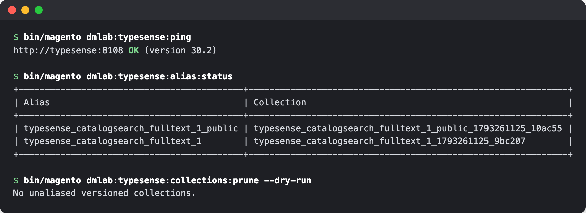

# DmLab_TypesenseCore

[](https://github.com/dmlab-work/module-typesense-core/actions/workflows/ci.yml) [](https://codecov.io/gh/dmlab-work/module-typesense-core) [](https://packagist.org/packages/dmlab/module-typesense-core) [](https://packagist.org/packages/dmlab/module-typesense-core) [](https://packagist.org/packages/dmlab/module-typesense-core) [](LICENSE) 

Keeps a Typesense-powered Magento store answering when a search node drops by failing over to the next node.
Swaps a rebuilt index in with no downtime, and gives you three CLI checks: node health, which index is live, and
leftover collections to clean up. `typesense-search` and `typesense-indexer` install it for you, so you rarely
require it directly.



## Install

```bash
composer require dmlab/module-typesense-core
bin/magento module:enable DmLab_TypesenseCore
bin/magento setup:upgrade
```

The usual path is `composer require dmlab/module-typesense-search`, which pulls in core and the indexer.

## Requirements

Magento 2.4.7+ · PHP 8.2–8.5 · `ext-curl` · Typesense ≥ 30.0 (synonym sets API), verified on 30.2.

## CLI

- `bin/magento dmlab:typesense:ping` — checks every node and the API key; exits non-zero if a node is down or
  unhealthy, the key is rejected, or no key is configured.
- `bin/magento dmlab:typesense:alias:status` — shows which collection each index name serves right now, and counts
  leftover copies `collections:prune` would clean up.
- `bin/magento dmlab:typesense:collections:prune [--dry-run] [--min-age=86400]` — drops old index copies nothing
  serves anymore; copies younger than `--min-age` seconds are kept, as a rebuild may still be waiting to go live.

Pairs with [typesense-indexer](https://github.com/dmlab-work/module-typesense-indexer), [typesense-search](https://github.com/dmlab-work/module-typesense-search) and [typesense-instant-search](https://github.com/dmlab-work/module-typesense-instant-search).

## Integration tests

`Test/Integration/` runs against a real Typesense and is skipped unless `TYPESENSE_TEST_URL` and
`TYPESENSE_TEST_API_KEY` are set:

```bash
docker exec -w /var/www/html/m2-modules/module-typesense-core -e MAGENTO_ROOT=/var/www/html \
  -e TYPESENSE_TEST_URL=http://typesense:8108 -e TYPESENSE_TEST_API_KEY=<key> \
  magento-app php /var/www/html/vendor/bin/phpunit -c Test/Integration/phpunit.xml
```

## Architecture

L0 of the DMLab Typesense suite: pure transport with no catalog knowledge, and it reads no configuration of its own.

### What it provides

- **HTTP client** — node failover, typed errors; `magento/framework` only, no SDK.
- **Health check** — cached and non-throwing, over `GET /health`; `verifyConnection()` returns an uncached
  `ConnectionStatus` (`ok` / `unreachable` / `unauthorized`) and checks the key against `GET /debug`, since
  `/health` accepts any key. Pass a `ConnectionSettingsInterface` to check unsaved settings.
- **Collections** — create / get / exists / drop / PATCH / `getList()`, plus zero-downtime alias `swap()`
  (per-alias lock; refuses a missing target).
- **Documents** — upsert, delete, delete-by-filter, chunked import; an unencodable document is a per-document
  failure, not an aborted batch.
- **Synonyms** — `SynonymSetManager` upsert / delete / exists over Typesense synonym sets.
- **Schema reconciler** — decides in-place PATCH vs rebuild; holds no documents itself.
- **CLI details** — `ping` reports `OK` / `DOWN` / `UNHEALTHY` / `KEY REJECTED` per node; without a key it still
  probes `/health` and exits non-zero. `collections:prune` drops versioned `<alias>_<ts>_<hex>` collections no
  alias points to, never those of a removed alias, and rechecks each candidate under the per-alias lock
  `AliasManager::swap()` takes.

### Resilience

- **Deadline** per call: `deadline` option, default `timeout × 2`; each attempt's timeout is capped by what remains.
- **Timeouts** are retried at most once per node.
- **Node memory**: a failed node is cached as down for 30 s and meanwhile tried once per call, only after every
  unmarked node has failed.
- **Backoff**: jittered sleep between rounds (100 ms base, 1 s cap).
- **Logging**: one warning per node failure (URL + status/error, never headers).
- **Writes** fail over only when the request provably never left (curl errno 6/7 or a connect-phase timeout);
  otherwise a `POST`/`PATCH` is sent once, as a replay could 409 a create that succeeded. `replaySafe`: `null` =
  by method (`GET`/`HEAD`/`PUT`/`DELETE` retry), `true` = opt in, `false` = opt out. Upserts and
  `upsert`/`update`/`emplace` imports opt in when every document carries a string `id`.

### Config seams

Everything is injected by `typesense-indexer`:

- **`Api\ConnectionSettingsInterface`** — nodes (each with its own `http`/`https`), decrypted API key, timeouts,
  retry, health-cache TTL. Core binds a `NotConfigured` default that throws until the indexer supplies the reader.
- **`Model\Schema\ReconcilePolicy`** — `Reconciler::reconcile()` receives its rebuild threshold and decision
  override as an argument, not from config.

### Extending the schema

`FieldSpec` models `name`/`type`/`facet`/`index`/`sort`/`optional`; any other Typesense field property (`embed`,
`num_dim`, `hnsw_params`, …) passes through its `extra` map verbatim. There is no per-field weight — Typesense
weights are a query-time concern.

## License

OSL-3.0 © DMLab.
